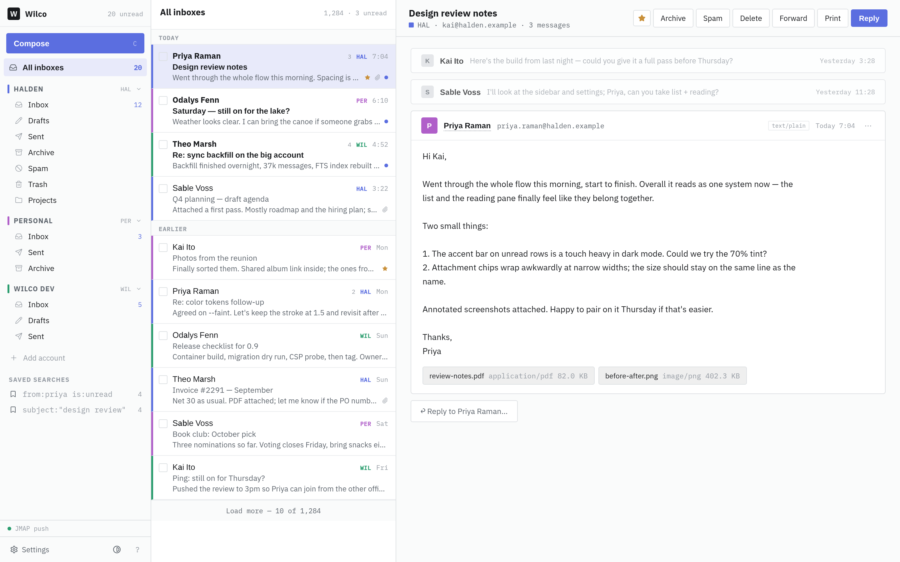

# Wilco

A self-hosted, single-user email client over JMAP. It puts several mail
accounts into one fast, keyboard-driven inbox, keeps a full local copy of your
mail so search is instant, and renders other people's HTML where it cannot
touch the app. Node server with zero runtime dependencies, SQLite + FTS5,
Preact client. Tested against Fastmail.

- **Install:** [INSTALL.md](INSTALL.md) — one container plus a TLS proxy with two hostnames.
- **Develop:** [CONTRIBUTING.md](CONTRIBUTING.md).
- **Design:** [docs/design/](docs/design/) — the visual design and its reference renders.

## What sets it apart

**Every account in one inbox.** Add as many JMAP accounts as you like; their
mail lands in one unified list, each message marked by its account's colour
and code. Open, archive or reply to anything without leaving that list —
replies go out from the account the message arrived in. Any account can be
kept out of the unified view and read on its own. Accounts are added from the
app, take effect immediately, and the token is checked before it is stored.

**Search that runs on your machine.** Wilco syncs each account into a local
SQLite database with a full-text index, so search does not round-trip to the
mail server and does not wait on it. Results arrive as you type, with matches
highlighted, across every account at once:

| Operator | Matches |
|---|---|
| `from:` `to:` `cc:` | sender or recipients, by name or address |
| `acct:` | one account |
| `in:` | a folder, by name or role |
| `is:unread` `is:read` `is:flagged` | message state |
| `has:attachment` | messages carrying a file |
| `before:2026-01-31` `after:2026-01-01` `newer_than:7d` | dates |

Combine operators with free text. Searches can be saved to the sidebar.

**Spam marking that trains the right filter.** A provider's spam filter
learns only from the folder its training points at, and that is not always
the folder with the `junk` role: an account can hold both a "Spam" and an
"Identified Spam" folder, and spam filed into the wrong one teaches nothing.
Wilco makes you choose the training folder per account, files every
"mark as spam" there, and refuses to guess when none is set.

**One address book across accounts.** The To field suggests anyone you have
corresponded with from any account, ranked by how often and how recently.
If you usually write to someone from a different account than the one you
are sending from, Wilco says so and offers to switch.

**Fast at any size.** The list is one row per conversation, scroll-paged from
the local database, and a page costs the same in a folder of a hundred
messages as in one of a hundred thousand. New mail arrives by JMAP push and is
streamed to the browser over server-sent events.

**Built for the keyboard.** Every common action has a key, and `⌘K` opens a
command palette for the rest:

| Key | Action | Key | Action |
|---|---|---|---|
| `j` / `k` | next / previous | `c` | compose |
| `⏎` | open | `r` / `a` / `f` | reply / reply all / forward |
| `e` | archive | `⌘⏎` | send |
| `#` | delete | `s` | flag |
| `x` | select | `z` | undo |
| `u` | all inboxes | `/` | search |
| `g i` `g a` `g s` `g d` `g t` `g f` | go to inbox, archive, sent, drafts, trash, flagged | `[` / `]` | previous / next folder |
| `t` | toggle theme | `?` | every shortcut |

## Features

- **Reading:** conversation view, sanitized HTML with remote images blocked
  until you allow them per message, plaintext shown as written, in-app image
  attachments, print view, one-click unsubscribe (RFC 8058, performed
  server-side).
- **Triage:** archive, delete, flag, mark as spam, move to any folder by menu
  or drag and drop, multi-select, mark all read, and undo for all of it.
  Archive and move act on the whole conversation in the folder you are
  viewing. Nothing is ever deleted outright: Trash and Spam are moves the
  provider retains.
- **Compose:** a rich-text editor with Fastmail's formatting toolbar, paste
  that keeps its structure, an editable quoted original, attachments by
  button or drag and drop, autosaved drafts, and your provider's HTML
  signatures, placed above or below the quote by preference. Images in a
  signature are sent as inline parts so recipients' clients keep them.
- **Accounts and settings:** per-account label, code, spam folder and
  signature; desktop notifications for new mail; light and dark themes
  painted from the first frame; layouts for wide screens, tablets and phones.
- **API:** the app's own JSON API, usable with scoped, expiring bearer tokens
  (read by default; write only when asked for).

## How it works

The server holds every JMAP token, sealed with a master key, and syncs each
account into a local SQLite cache; the browser never sees a token and talks
only to Wilco's own JSON API. Search runs over POST so a query never lands in
a proxy's access log.

Message HTML never enters the app's page. It is sanitized server-side and
served from a second hostname under a short-lived capability token, into a
sandboxed iframe with a strict CSP, so a sender's markup is isolated from the
app by origin. The sanitizer is the second line of defence, not the first.
Remote images stay blocked until you allow them, and link-preconnect hints,
which can confirm an open without loading any image, are always removed.

## Limits

- Single user. One login, every account belongs to it.
- JMAP only; no IMAP. Developed and tested against Fastmail.
- Composing needs a window at least 1024px wide; below that the composer is
  not shown (drafts autosave, so nothing is lost).
- PDF attachments download rather than preview.
